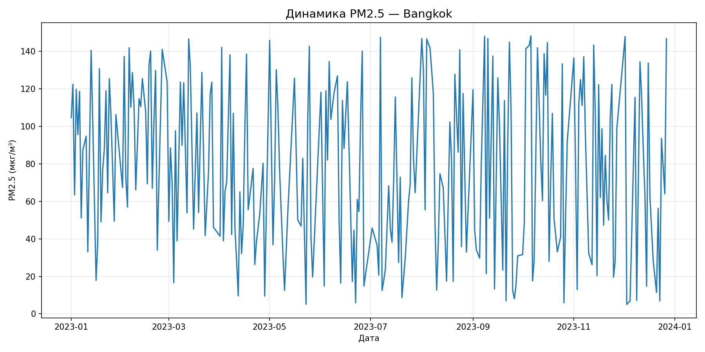
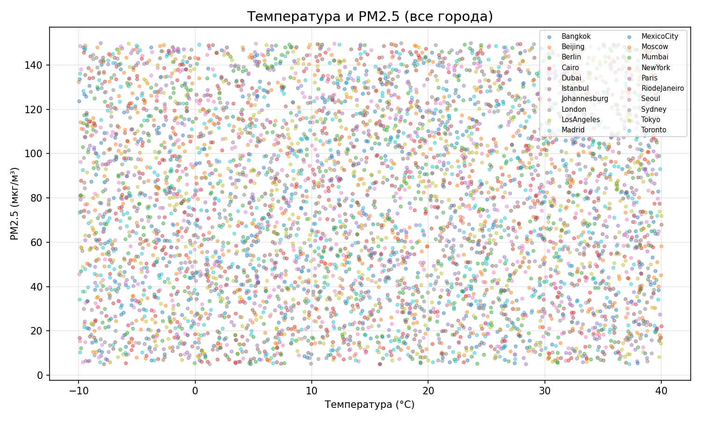
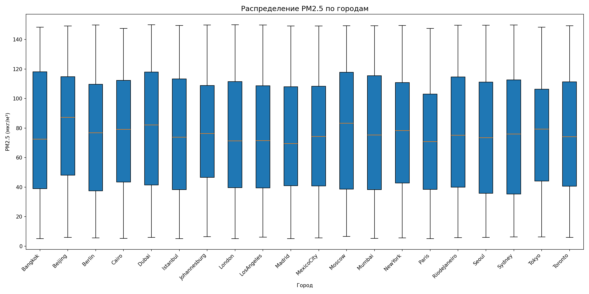
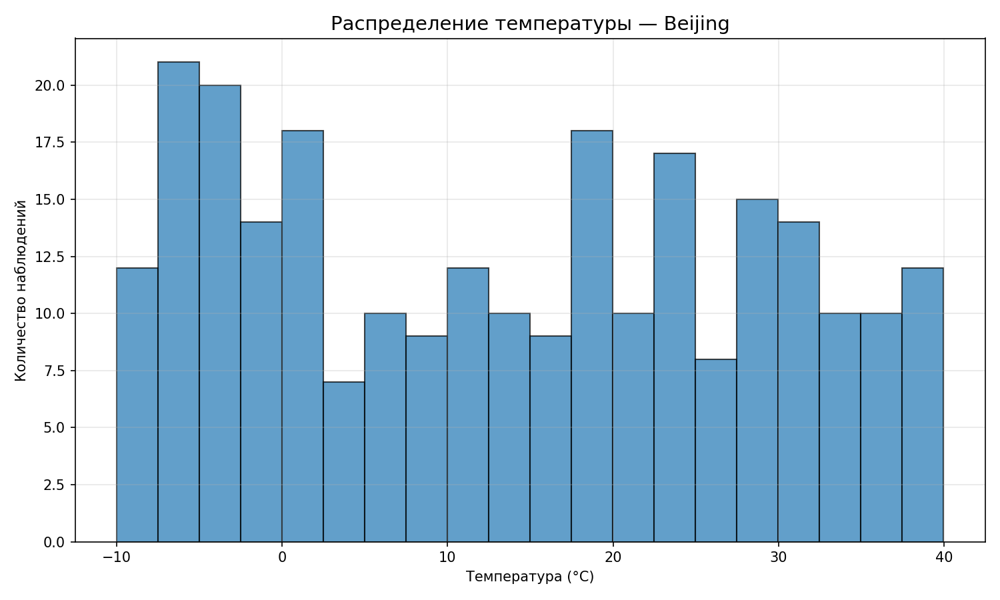
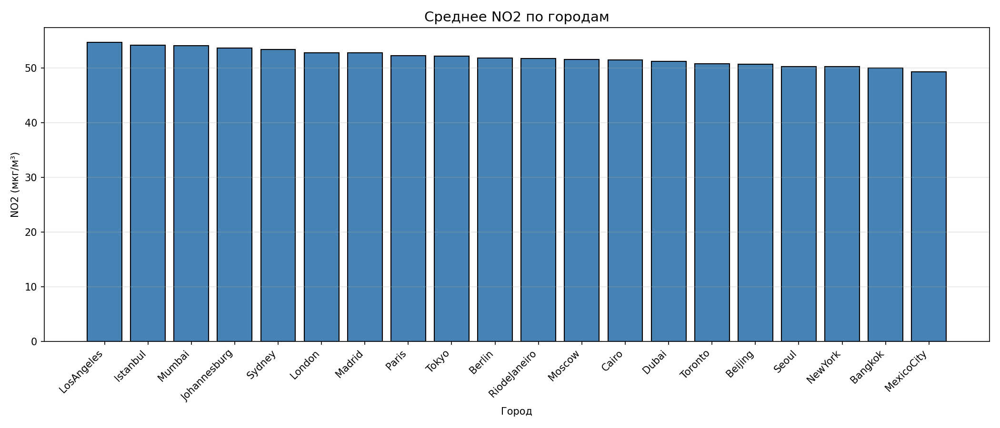

# 🌍 Анализ качества воздуха по городам мира

> Информационно-аналитическая desktop-система для исследования качества воздуха, климатических условий и уровня загрязнения в 20 крупных городах мира.

Приложение позволяет загружать и редактировать данные о качестве воздуха, формировать аналитические отчёты, строить графики и исследовать взаимосвязи между загрязнением атмосферы и погодными условиями.

Проект разработан на **Python** с использованием `Tkinter`, `Pandas` и `Matplotlib` и предоставляет графический интерфейс для работы со всей функциональностью системы.

---

## 📌 О проекте

Проект предназначен для анализа набора данных о качестве воздуха в различных городах мира.

Для каждого наблюдения доступны показатели загрязнения атмосферы и метеорологические характеристики:

- **PM2.5** — концентрация мелкодисперсных частиц;
- **PM10** — концентрация взвешенных частиц;
- **NO₂** — концентрация диоксида азота;
- **CO** — концентрация угарного газа;
- **Temperature** — температура воздуха;
- **Humidity** — влажность;
- **Wind Speed** — скорость ветра;
- **Date** — дата наблюдения;
- **City** — город.

Данные хранятся отдельно для каждого города и могут быть объединены в единую таблицу для проведения сравнительного анализа.

---

## 🎯 Цели проекта

Основные задачи системы:

- анализ уровня загрязнения воздуха;
- сравнение показателей между городами;
- исследование динамики PM2.5;
- изучение связи между температурой и загрязнением;
- анализ климатических факторов;
- получение статистических характеристик данных;
- формирование сводных таблиц;
- визуализация результатов;
- редактирование и управление данными через GUI.

---

## 🌎 Исследуемые города

В проекте представлены данные для **20 городов**:

| | Город | | Город |
|---|---|---|---|
| 🇹🇭 | Bangkok | 🇨🇳 | Beijing |
| 🇩🇪 | Berlin | 🇪🇬 | Cairo |
| 🇦🇪 | Dubai | 🇹🇷 | Istanbul |
| 🇿🇦 | Johannesburg | 🇬🇧 | London |
| 🇺🇸 | Los Angeles | 🇪🇸 | Madrid |
| 🇲🇽 | Mexico City | 🇷🇺 | Moscow |
| 🇮🇳 | Mumbai | 🇺🇸 | New York |
| 🇫🇷 | Paris | 🇧🇷 | Rio de Janeiro |
| 🇰🇷 | Seoul | 🇦🇺 | Sydney |
| 🇯🇵 | Tokyo | 🇨🇦 | Toronto |

---

## ✨ Возможности

### 📊 Аналитические отчёты

Система позволяет формировать несколько типов текстовых отчётов.

#### Высокий уровень PM2.5

Можно задать минимальный порог концентрации PM2.5 и получить записи, соответствующие условию.

Результат сортируется по уровню загрязнения:

```text
PM2.5 >= заданного значения
```

#### 🌡️ Загрязнение при заданной температуре

Позволяет выбрать диапазон температуры и получить соответствующие показатели загрязнения:

- PM2.5;
- NO₂;
- CO;
- температура;
- город;
- дата.

#### 💧 Климатический анализ

Можно отфильтровать записи по:

- минимальной влажности;
- минимальной скорости ветра.

После этого система показывает соответствующие значения PM2.5 и PM10.

#### 🏙️ Сводная статистика по городам

Формируется `pivot table`, содержащая средние значения показателей для каждого города.

Анализируются:

- PM2.5;
- PM10;
- NO₂;
- CO;
- Temperature;
- Humidity;
- Wind Speed.

#### 📈 Описательная статистика

Для числовых показателей рассчитываются:

- минимум;
- максимум;
- среднее значение.

#### 🔢 Частотный анализ

Для выбранного категориального признака строится таблица частот:

- значение;
- количество;
- процент от общего числа наблюдений.

---

# 📈 Визуализация

Система умеет автоматически строить и сохранять графические отчёты в формате PNG.

### 📉 Динамика PM2.5

Линейный график показывает изменение концентрации PM2.5 во времени для выбранного города.



---

### 🌡️ Температура и PM2.5

Диаграмма рассеяния позволяет исследовать возможную связь между температурой воздуха и концентрацией PM2.5.



График можно построить:

- для одного города;
- одновременно для всех городов.

---

### 📦 Распределение PM2.5

Boxplot позволяет сравнить распределение концентрации PM2.5 между городами и увидеть медианы, разброс и выбросы.



---

### 📊 Распределение температуры

Для анализа температуры используются гистограммы.



Гистограмма может строиться как для отдельного города, так и для всего набора данных.

---

### 🏙️ Сравнение загрязнения

Система также формирует столбчатые диаграммы для сравнительного анализа показателей загрязнения между городами.



---

# 🖥️ Графический интерфейс

Приложение построено на `Tkinter` и предоставляет единое desktop-окно для работы с данными.

Через интерфейс доступны:

- загрузка базы данных;
- просмотр записей;
- выбор города;
- редактирование данных;
- удаление записей;
- формирование текстовых отчётов;
- построение графиков;
- настройка внешнего вида;
- управление справочником городов.

---

## ⚙️ Управление данными

### 📥 Загрузка

Исходные данные находятся в Excel-файле.

Для ускорения дальнейшей работы система преобразует данные в отдельные `pickle`-файлы:

```text
Excel
  │
  ├── Bangkok.xlsx → Bangkok.pckl
  ├── Beijing.xlsx → Beijing.pckl
  ├── Berlin.xlsx  → Berlin.pckl
  ├── ...
  └── Toronto.xlsx  → Toronto.pckl
```

После этого данные всех городов могут быть объединены в единый `DataFrame`.

---

### ✏️ Редактор данных

В системе предусмотрен отдельный редактор базы данных.

Он позволяет:

- выбрать город;
- просмотреть его записи;
- добавить новую запись;
- удалить запись;
- работать с данными непосредственно через графический интерфейс.

---

### 🏙️ Справочник городов

Отдельное окно позволяет просматривать список доступных городов и количество записей по каждому из них.

Также предусмотрено удаление записей выбранного города из текущей базы данных.

---

## 🎨 Настройки интерфейса

Внешний вид приложения вынесен в отдельный конфигурационный файл:

```text
scripts/config.ini
```

Можно настроить:

- цвет фона;
- цвет текста;
- цвет кнопок;
- цвет полей ввода;
- основной шрифт;
- размер шрифта;
- размеры главного окна.

Пример конфигурации:

```ini
[colors]
bg = #003580
fg = #FFD700
btn_bg = #003580
btn_fg = #FFD700
entry_bg = #001840
entry_fg = #FFD700
header_bg = #001040

[fonts]
main = Arial
size_normal = 11
size_header = 14
size_small = 9
```

Настройки можно изменять непосредственно из приложения.

---

# 🏗️ Архитектура проекта

Проект разделён на несколько логических компонентов.

```text
python-analysis/
│
├── data/
│   ├── Bangkok.pckl
│   ├── Beijing.pckl
│   ├── ...
│   └── Toronto.pckl
│
├── graphics/
│   ├── Bangkok_pm25_line.png
│   ├── Bangkok_temp_pm25_scatter.png
│   ├── ...
│   └── bar_NO2.png
│
├── images/
│
├── library/
│   ├── __init__.py
│   └── utils.py
│
├── notes/
│   ├── developer_guide.docx
│   ├── presentation.pptx
│   └── user_guide.docx
│
├── scripts/
│   ├── __init__.py
│   ├── config.ini
│   ├── loaders.py
│   ├── main.py
│   ├── graphic_reports.py
│   └── text_reports.py
│
├── output/
│
└── README.md
```

---

## 🧩 Основные модули

### `scripts/main.py`

Главный модуль приложения.

Отвечает за:

- запуск GUI;
- создание окон;
- навигацию;
- взаимодействие пользователя с системой;
- загрузку данных;
- запуск отчётов;
- запуск визуализаций;
- редактирование базы данных;
- настройки интерфейса.

---

### `scripts/loaders.py`

Модуль работы с данными.

Основные функции:

```python
create_pickle_database()
load_city()
save_city()
load_all_data()
get_city_list()
```

Он отвечает за преобразование исходного Excel-файла в набор `pickle`-файлов и последующую загрузку данных.

---

### `scripts/text_reports.py`

Модуль аналитических отчётов.

Содержит:

```python
high_pm25_report()
temperature_pollution_report()
climate_report()
pivot_pollution_report()
statistics_report()
frequency_report()
```

Все функции принимают `pandas.DataFrame` и возвращают подготовленные аналитические таблицы.

---

### `scripts/graphic_reports.py`

Модуль визуализации.

Содержит функции для построения:

```python
pm25_line_plot()
temperature_pm25_scatter()
pm25_boxplot()
temperature_histogram()
pollution_bar_chart()
```

Графики отображаются пользователю и при необходимости сохраняются в директорию:

```text
graphics/
```

---

### `library/utils.py`

Набор универсальных функций проекта.

Используется для:

- работы с конфигурацией;
- создания элементов интерфейса;
- стилизации виджетов;
- вывода информационных сообщений;
- обработки ошибок;
- создания необходимых директорий.

---

# 🔄 Общая схема работы

```text
                 ┌──────────────────┐
                 │   Excel-данные   │
                 └────────┬─────────┘
                          │
                          ▼
                 ┌──────────────────┐
                 │     loaders.py   │
                 └────────┬─────────┘
                          │
                          ▼
                ┌────────────────────┐
                │  Pickle-база данных│
                └─────────┬──────────┘
                          │
                          ▼
                ┌────────────────────┐
                │   pandas.DataFrame │
                └─────────┬──────────┘
                          │
             ┌────────────┼────────────┐
             ▼            ▼            ▼
       ┌──────────┐ ┌───────────┐ ┌────────────┐
       │ Фильтры  │ │ Статистика│ │ Визуализация│
       └────┬─────┘ └─────┬─────┘ └──────┬─────┘
            │             │              │
            ▼             ▼              ▼
       ┌──────────┐ ┌───────────┐ ┌────────────┐
       │ Отчёты   │ │ Pivot      │ │ PNG-графики│
       └──────────┘ └───────────┘ └────────────┘
```

---

# 🛠️ Технологический стек

| Технология | Назначение |
|---|---|
| 🐍 Python | Основной язык разработки |
| 🐼 Pandas | Работа с табличными данными |
| 📊 Matplotlib | Построение графиков |
| 🖥️ Tkinter | Графический интерфейс |
| 📑 Excel | Исходный формат данных |
| 🗃️ Pickle | Хранение подготовленных данных |
| ⚙️ ConfigParser | Работа с настройками приложения |
| 📁 pathlib | Работа с файловой системой |

---

# 📦 Установка

## 1. Клонирование репозитория

```bash
git clone https://git.miem.hse.ru/blank2465804/python-analysis.git
cd python-analysis
```

## 2. Создание виртуального окружения

### Windows

```bash
python -m venv .venv
.venv\Scripts\activate
```

### Linux / macOS

```bash
python3 -m venv .venv
source .venv/bin/activate
```

---

## 3. Установка зависимостей

Установите необходимые библиотеки:

```bash
pip install pandas matplotlib numpy openpyxl
```

`Tkinter` обычно входит в состав Python.

Для Linux при необходимости:

```bash
sudo apt install python3-tk
```

---

# ▶️ Запуск

Запустите главный модуль:

```bash
python scripts/main.py
```

После запуска откроется графическое окно приложения.

---

# 📊 Пример рабочего сценария

Типичный сценарий использования:

```text
1. Запуск приложения
       ↓
2. Загрузка базы данных
       ↓
3. Выбор города
       ↓
4. Просмотр данных
       ↓
5. Формирование отчёта
       ↓
6. Построение графика
       ↓
7. Анализ результата
       ↓
8. Сохранение отчёта / изображения
```

---

# 📚 Документация

В директории `notes/` находятся дополнительные материалы проекта:

- `user_guide.docx` — руководство пользователя;
- `developer_guide.docx` — руководство разработчика;
- `presentation.pptx` — презентация проекта.

---

# 🚀 Возможные направления развития

Проект можно развивать дальше:

- [ ] добавить автоматическое обновление данных;
- [ ] добавить импорт CSV;
- [ ] добавить экспорт отчётов в PDF;
- [ ] добавить экспорт результатов в Excel;
- [ ] добавить корреляционный анализ;
- [ ] добавить тепловую карту корреляций;
- [ ] добавить интерактивные графики;
- [ ] добавить фильтрацию по диапазону дат;
- [ ] добавить сравнение нескольких выбранных городов;
- [ ] добавить автоматическое ранжирование городов по уровню загрязнения;
- [ ] добавить расчёт AQI;
- [ ] добавить более гибкую систему фильтров;
- [ ] добавить автоматические тесты;
- [ ] добавить полноценный `requirements.txt`;
- [ ] упаковать приложение в исполняемый файл для Windows.

---

# 🎓 Учебная ценность

Проект объединяет несколько важных направлений разработки:

**Data Analysis**

Работа с реальными табличными данными, фильтрация, агрегация, статистика и построение сводных таблиц.

**Data Visualization**

Создание различных типов графиков для поиска закономерностей и сравнения показателей.

**Desktop Development**

Создание полноценного пользовательского интерфейса на Tkinter.

**Software Architecture**

Разделение проекта на модули, отвечающие за загрузку данных, аналитику, визуализацию и вспомогательные функции.

**Data Management**

Хранение, загрузка, редактирование и объединение данных.

---

# 👨‍💻 Авторы

- **Капитанов Антон**
- **Родионов Игорь**
- **Коноплев Кирилл**

---

## 📄 Лицензия

Проект разработан в учебных целях.

Если код используется или модифицируется, рекомендуется сохранять информацию об авторах проекта.